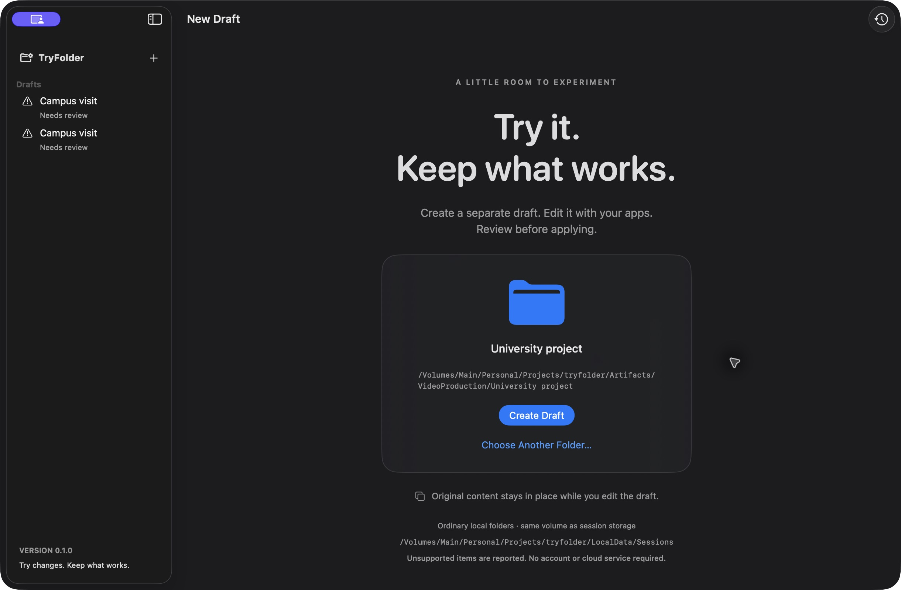
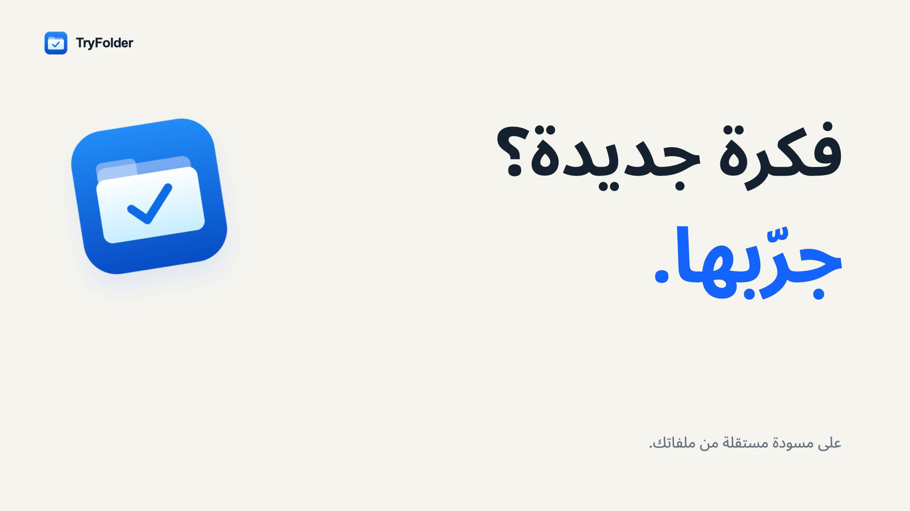
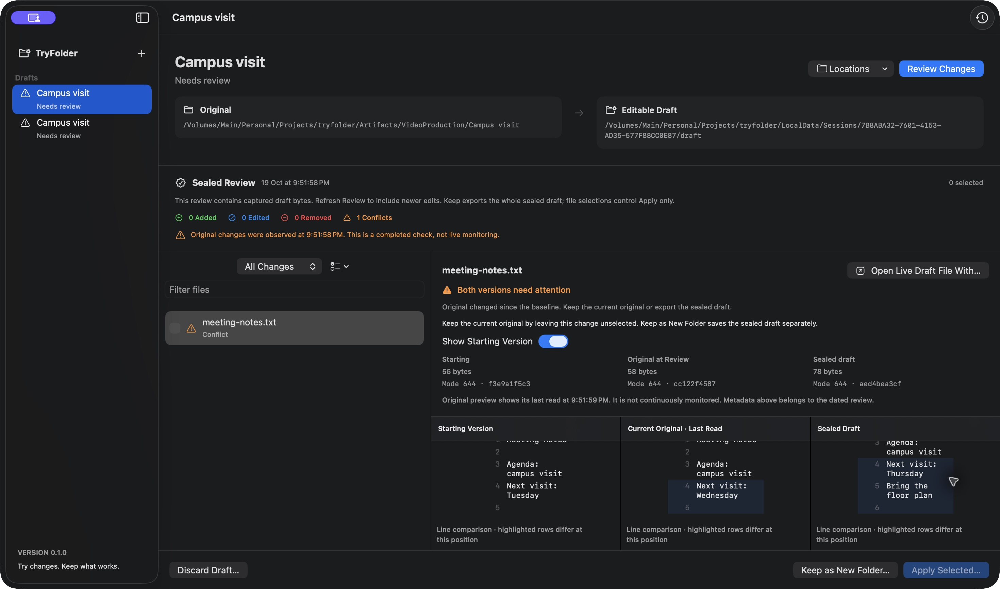

Try changes to a folder. Keep what works.
================================================

TryFolder is a native macOS app for creating a separate draft of an ordinary folder, editing it with your usual apps, and reviewing the resulting files.

**0.1.0 · Apple Silicon · macOS 14+**. Guarded **Apply** and **Undo** are enabled in this release, alongside **Keep as New Folder** and **Discard Draft**. Native verification, packaging, and performance evidence is tracked in [VERIFICATION.md](Docs/VERIFICATION.md). Local builds are ad-hoc signed, **not Developer ID signed or notarized**. Source is public at [SaudNull/tryfolder](https://github.com/SaudNull/tryfolder). The normal [0.1.0 release](https://github.com/SaudNull/tryfolder/releases/tag/v0.1.0) is published with an [ad-hoc signed Apple Silicon archive](https://github.com/SaudNull/tryfolder/releases/download/v0.1.0/TryFolder-0.1.0-macos-arm64-local.zip) and [SHA256 checksums](https://github.com/SaudNull/tryfolder/releases/download/v0.1.0/SHA256SUMS.txt). There is no Homebrew cask. This build is ad-hoc signed only, so a downloaded archive may be blocked by Gatekeeper. The reproducible source build below is the supported installation path until Developer ID distribution is available.

Actual running-app screenshot using synthetic university/campus files.

## Watch the demo · شاهد الديمو

**[Watch the narrated Arabic demo · شاهد بصوت عربي](https://github.com/SaudNull/tryfolder/releases/download/v0.1.0/TryFolder-V2-AR.mp4)** — 35.5 seconds, 1080p/60 fps, with Saudi Arabic narration generated in ElevenLabs and a new Remotion edit. Actual native-app recordings show independent drafts, ordinary editing, review, keep/discard, and source conflicts. The film combines synthetic examples and shortened/accelerated footage. The app interface is currently English.

Earlier silent cuts: [English overview](https://github.com/SaudNull/tryfolder/releases/download/v0.1.0/TryFolder-Main-EN.mp4) · [English conflict example](https://github.com/SaudNull/tryfolder/releases/download/v0.1.0/TryFolder-Conflict-EN.mp4). See [demo scope and verification](Docs/DEMO.md).

## Three steps

1. **Create a draft.** Choose or drop a supported folder. TryFolder captures a baseline, then creates the editable draft from that baseline.
2. **Edit normally.** Open the exact Draft location in Finder or your editor. The Original and Draft paths are labeled separately.
3. **Review and keep.** Review added, edited, removed, and conflicting files. Keep the entire sealed draft as a new folder, apply selected nonconflicting changes to the original, or discard the experiment. Refresh Review to include later draft edits.

The core app processes files locally. It needs no account, subscription, API key, or hosted service. A draft is independent file content, **not a security sandbox**. If you give its path to an AI tool or script, that tool keeps its own permissions and must be told to work on those copies.

## Build and install locally

Tested on Apple Silicon with macOS 26.4.1. The deployment target is macOS 14; macOS 14 has not been tested. Building requires an Apple Silicon Mac, macOS 14 or later, and an installed Xcode toolchain with Swift 6.0 or later (`swift --version`). Intel and universal binaries are deferred. Obtain a source checkout with `git clone https://github.com/SaudNull/tryfolder.git`, then:

1. In Terminal, change into the checkout and run `./script/test.sh`.
2. Run `./script/package.sh`. It builds `dist/TryFolder.app`, creates `dist/TryFolder-0.1.0-macos-arm64-local.zip`, and writes `dist/SHA256SUMS.txt`.
3. Open `dist/TryFolder.app` in Finder or run `open dist/TryFolder.app`. You may copy this locally built bundle to Applications. For a downloaded build, use a verified signed release when available; these instructions do not change Gatekeeper settings.

For this checkout on the SSD, double-click `script/launch-ssd.command` after building to use `LocalData/Sessions` on the same volume without rebuilding. Keep the SSD connected.

For development, `./script/build_and_run.sh` builds a debug bundle and launches it. It first asks existing TryFolder processes to terminate; finish ongoing work before running it. `./script/build_and_run.sh --demo` uses `LocalData/Sessions` inside the checkout, useful for the SSD fixture on the same volume. Build/cache outputs remain in `.build`, `.cache`, and `dist` inside the checkout.

## Supported folders and exclusions

Only explicitly selected ordinary local directories and regular files on the **same volume as session storage** are supported. The default store is `~/Library/Application Support/TryFolder/Sessions`; sources on a different volume are rejected. An explicit development `--store /absolute/path` may select a disjoint store on the source volume. Automated verification used the named APFS SSD volume `/Volumes/Main`, with source and test session storage both on it. General external-volume behavior and cross-volume operation are not established.

- Plain text, images, PDFs, and other regular document files participate at the file level. Binary files are reported as changed; TryFolder does not interpret arbitrary document internals. Preview availability and size are bounded.
- Symlinks, hard links, special files, nested volumes, network/cloud-managed locations and placeholders, bundles/application libraries, live databases, protected system locations, credential stores, and unsupported ACLs/filesystem flags are rejected with affected paths.
- `.DS_Store`, `.git`, `node_modules`, `.build`, `build`, `dist`, `DerivedData`, `.venv`, `venv`, and `__pycache__` are excluded and reported. The exported draft omits them. Never assume an exported code folder includes its dependencies or Git history.
- Renames currently appear as add/remove pairs. Ambiguous case/Unicode collisions and case-only rename plans are rejected. Full Arabic UI localization is deferred; mixed-language filenames are part of the acceptance scope.

Relevant file permissions, extended attributes (including resource forks and quarantine), and timestamps are preserved by the copy implementation. Comparisons use content, mode, and extended attributes; timestamp-only touches are not semantic edits. TextEdit’s UF_TRACKED document flag is preserved on independent copies; it follows native pathname identity during Apply/Undo and is excluded from semantic comparisons. Other file flags remain unsupported. Directory metadata versioning is outside this release. Unsupported metadata fails rather than being silently stripped. Platform verification limits are recorded in [the QA matrix](Docs/QA-MATRIX.md).

## Keeping, discarding, and recovery

**Keep as New Folder** exports the whole captured review to an explicitly chosen, nonexistent destination outside source/session trees. It does not merge or replace an existing folder. File selection is reserved for Apply and does not limit the export. A successful export belongs to you; discarding its old session must leave it intact. Source conflicts or a missing source need not prevent keeping valid reviewed draft bytes.

**Discard Draft** archives the session logically and retains its bytes. It does not reclaim their disk space; automatic retention cleanup is deferred. Sessions live in durable storage, not a temporary directory. The current backend makes full, metadata-preserving file copies. Baseline, draft, reviews, and recovery material can use substantial disk space. Copy-on-write cloning is deferred; there is no instant-copy or zero-storage claim.

**Apply** asks for explicit confirmation and uses selected sealed review bytes. Save and close relevant editors first. It revalidates originals, preserves recovery copies, journals each operation, and verifies the result. Conflicting paths cannot be applied; keep the current original by leaving them unselected, or save the draft separately. Apply is a file-by-file transaction, not a globally atomic folder replacement.

**Undo** is a separate guarded operation: it reverses the recorded Apply only while current files still match its expected result. A later external edit causes a conflict and is preserved. Interrupted operations retain their journal and required versions for recovery; ambiguous disk state requires attention. Automated checks cover the scenarios described below, not every disk failure or concurrent writer.

Review status describes a dated observation. Other apps can change originals afterward. A sealed review is validated app-managed content, not tamper-proof against other processes running as you. Keep independent backups of important work.

## Verification and contributions

The integrated XCTest suite passed **47 test methods, 0 failures, in 17.006 seconds** (26 acceptance, 8 security, 13 core); one method contains **50 competing-export contests**. Separately, **36 subprocess interruption/recovery scenarios** passed using actual `_exit(86)` termination at Apply/Undo boundaries, with recovery and idempotence checks. These checks use disposable synthetic data and do not simulate power loss or hardware failure. Local evidence: `Artifacts/test-results.txt` and `Artifacts/process-crash-results.json`.

Native Finder/TextEdit verification exercised three draft changes, export, a selected text Apply, and Undo restoring all seven original hashes; discarding retained the kept folder. A second TextEdit scenario preserved a Wednesday original against a Thursday draft from a Tuesday baseline, showed the conflict, and exported the draft separately. PNG/PDF previews rendered, a later selected text Apply/Undo preserved other files and the conflict, and the last-read original preview refreshed correctly. The final fixed build survived switching PDF/text previews, opening and cancelling New Draft, and creating a new draft. Fresh edit/review/discard and Keep workflows passed. Quitting with a PDF visible and relaunching normally with no arguments restored the SSD session store and PDF previews in both panes.

A final single release-core measurement on 1,003 files totaling 138,313,745 bytes with three changes recorded preparation at **2.481 seconds** and review at **1.875 seconds** ([measurement data](Artifacts/performance-results.json)). Six short release-app idle samples while showing a restored sealed review each recorded **0.0% CPU**, with **74,432–74,576 KiB RSS** ([idle samples](Artifacts/performance-results.json)). These are observations on the tested machine, not general performance or long-duration idle guarantees.

The [QA matrix](Docs/QA-MATRIX.md) and [security review](Docs/SECURITY-REVIEW.md) describe automated scope and limits. [VERIFICATION.md](Docs/VERIFICATION.md) records final native smoke, package, and performance evidence. [Hosted CI passed](https://github.com/SaudNull/tryfolder/actions/runs/39307445317): 47 tests, zero failures, release build, strict signature, arm64 and checksum checks. An independent fresh HTTPS checkout of the published tag also passed all 47 tests and clean release/package checks; see the [independent QA receipt](Artifacts/public-source-check.json) and [hosted receipt](Artifacts/hosted-ci-results.json). Developer ID signing/notarization remains deferred.

See [CONTRIBUTING.md](CONTRIBUTING.md), the [filesystem contract](Docs/FILESYSTEM_CONTRACT.md), and the [bounded backlog](Docs/BACKLOG.md). MIT licensed; see [LICENSE](LICENSE).
